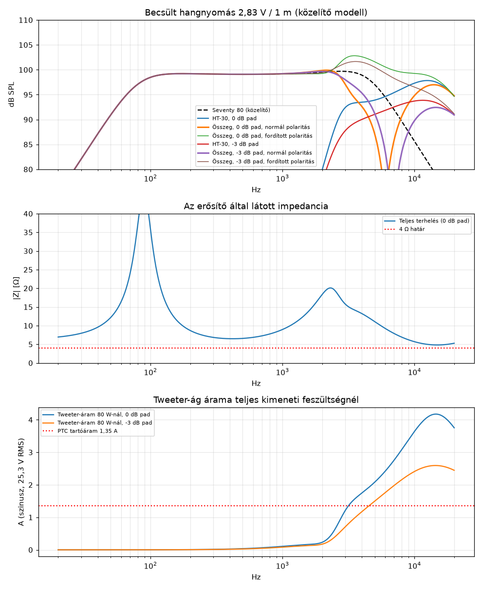

# 1. Magassugárzó (Monacor HT-30) és keresztváltó

## Kiinduló adatok

| | Celestion Seventy 80 | Monacor HT-30 |
|---|---|---|
| Impedancia | 8 Ω | 8 Ω |
| Érzékenység | kb. 99 dB/W/m | 98 dB/W/m |
| Sáv | kb. 75 Hz – 5 kHz | fx – 20 kHz, fs = 2 kHz |
| Terhelhetőség | 80 W | 50 W RMS / 100 W MAX |
| Egyéb | 12" | 60°×60°, kivágás Ø59 mm, mélység 45 mm |

A két hangszóró érzékenysége gyakorlatilag azonos, ezért **nem kell komoly csillapítás**. A gyártó legalább 5 kHz-es (12 dB/okt.) keresztváltást ír elő, a Seventy 80 viszont nagyjából itt kezd levágni. Az átvételi sávot a polaritással és szükség esetén az előfok presence-szabályzójával lehet kisimítani.

## Kapcsolás

```
Végfok + ──┬─────────────────────────────────────────────── Seventy 80 +
           │
           └──K2 (NO)──[PTC]──||──────┬──[Rs]──┬─────────── HT-30 −  (fordított polaritás)
                           C1 2,7 µF  │        │
                                 L1 0,39 mH  [Rp]
                                      │        │
Végfok − ──┬──────────────────────────┴────────┴─────────── HT-30 +
           └─────────────────────────────────────────────── Seventy 80 −
```

- **C1:** 2,7 µF MKP fólia, legalább 250 V. Elektrolit kondenzátor ne legyen, bipoláris sem.
- **L1:** 0,39 mH légmagos tekercs, legalább 0,8 mm-es huzal, egyenáramú ellenállás 0,3 Ω alatt. Vasmagos tekercs ne legyen, mert telítődik.
- **Pad, átkötővel (J-PAD):**
  - 0 dB: Rs helyén rövidzár, Rp nincs beültetve.
  - kb. −3 dB: Rs = 2,2 Ω, Rp = 18 Ω, mindkettő 10 W-os kerámiatestű ellenállás.
- **PTC:** Ihold kb. 1,35 A, Itrip kb. 2,7 A, **Vmax legalább 60 V**. Kioldott állapotban a teljes kimeneti feszültség rajta esik, ez 80 W-nál kb. 36 V csúcs.
- **K2:** a magassugárzó-ág reléje, lásd a [bemenetváltás](03-bemenetvaltas.md) leírását.
- A Seventy 80 **nem kap** aluláteresztő szűrőt.

## Szimulációs eredmények



Ezek közelítő modellek. A hangszórók paraméterei becsültek, a hangnyomás-görbék minimum-fázisú közelítések. A tendenciák helyesek, a pontos szinteket mérni kell.

- **Polaritás:** másodrendű szűrővel a **fordított** tweeter-polaritás a jó. A HT-30 + pólusa a végfok − pontjára kerül, a − pólusa a szűrő kimenetére.
  - Fordított polaritással 2–12 kHz között kb. 99–103 dB, a pad nélkül.
  - Normál polaritással 5–7 kHz között mély kioltás keletkezik.
- **Pad:** 0 dB-lel indulj. Ha túl fényes vagy „sziszeg”, tedd át −3 dB-re.
- **Impedancia:** a legkisebb érték kb. 4,8 Ω 15 kHz körül. A végfok ezt biztonságosan bírja, de egy 4 Ω-os külső láda **ne** legyen rákötve a módosított combóval egyszerre.
- **Tweeter-áram:** tartós szinuszjel 80 W-on 10 kHz fölött a PTC-t kioldaná. Ez a cél: ilyenkor a PTC védi a HT-30-at. Valós gitárjelben 5 kHz fölött csak a teljesítmény töredéke van, így normál játéknál a PTC nem old ki.
- **Elektromos -3 dB pont:** a HT-30 valós impedanciája miatt kb. 6,8 kHz. Ez nem hiba: a kürt saját hangnyomás-görbéjével együtt adja ki a fenti összegzett görbét.

## Védelem összefoglalva
1. **K2 relé:** elektromos (torzított) módban a magassugárzó le van kapcsolva.
2. **PTC:** tartós túlterhelésnél kiold, lehűlés után magától visszaáll.
3. **A szűrő és a gyári 5 kHz-es határ betartása:** a 2 kHz-es rezonancián a membrán nem kap nagy jelet. A szimuláció szerint 2 kHz-en kb. −15 dB a csillapítás.

## Opcionális korrekciók (csak mérés után)
Ha a mért impedanciagörbén a 2 kHz-es csúcs zavaró, vagy a hangban „csipogás” hallatszik:
- **Soros LCR csapda** a HT-30-cal párhuzamosan, a pad után, 2 kHz-re hangolva. L és C a mért csúcsszélességből számolható, R a csúcsmagasságból.
- **Zobel-tag** (R kb. 1,25·Re, C = Le/R²) a lengőtekercs-induktivitás kompenzálására. A HT-30 kis, 12 mm-es tekercse miatt valószínűleg felesleges.

### Impedanciamérés házilag
1. Kösd sorba a hangszórót egy 100 Ω-os ellenállással, és hajtsd meg egy jelgenerátorral vagy hangkártyával, 1 V körüli szinttel.
2. Mérd a feszültséget a hangszórón (Uh) és a jelforráson (Ug).
3. Számolj: Z ≈ 100 · Uh / (Ug − Uh).
4. Mérj 1/3 oktávonként 1 és 20 kHz között. Ingyenes programmal (REW, ARTA, LIMP) automatikusan is lehet.

## Mechanikai beépítés
- Ø59 mm-es kivágás a hangfal felső részén, a 12"-es kosár peremétől legalább 2–3 cm-re.
- Rögzítés négy facsavarral, alá vékony tömítőgyűrű, hogy ne zörögjön.
- A keresztváltót egy kis perfboardon vagy a hangfal belső oldalán, csavarozott sorkapcson érdemes elhelyezni. A tekercset a hangszóró mágnesétől legalább 10 cm-re tedd.
