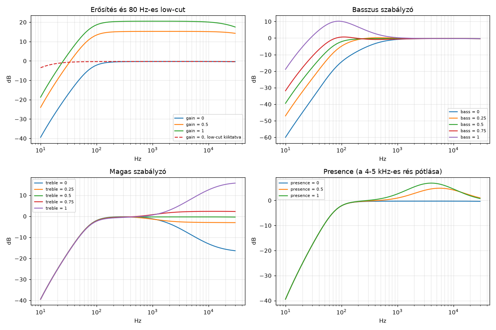

# 2. Akusztikus előfok (2 × TL072)

## Jelút

```
Akusztikus jack ─ U1A buffer/gain ─ U2A 80 Hz low-cut ─ U2B presence ─ U1B Baxandall ─ hangerő ─ K1 relé ─ reverb csomópont
                                        (S1 kiiktatja)
```

A Baxandall fokozat invertál. Ez nem gond, mert a K1 relé vált, nem keveri a két jelet.

## Táp
- **Forrás:** a gyári panel op-amp tápja, várhatóan ±15 V. **Bekötés előtt mérd meg.**
- **Szűrés tápáganként:**
  - 47 Ω soros ellenállás, utána 47 µF / 25 V elektrolit kondenzátor a földre,
  - minden TL072 8. és 4. lábánál 100 nF kerámia kondenzátor a földre.
- **Stabilizálás:**
  - Ha a táp ±18 V fölött van: 78L15 a pozitív és 79L15 a negatív ágba, mindegyik be- és kimenetén 100 nF.
  - Ha csak egyoldali táp van, pl. +24 V: virtuális föld kell, két 10 kΩ-os osztóval és 47 µF-tal, a 0 V helyett ehhez kötve. Ilyenkor a bemenet és a kimenet csatolókondenzátoros.
- **Föld:** egy pontban kösd a gyári jel-földhöz.

## TL072 lábkiosztás
1 = OUT A, 2 = IN− A, 3 = IN+ A, 4 = V−, 5 = IN+ B, 6 = IN− B, 7 = OUT B, 8 = V+

## Fokozatok

### U1A: buffer és erősítés (U1 1–3. láb)
| Alkatrész | Érték | Bekötés |
|---|---|---|
| R1 | 1 kΩ | jack meleg pont → C1 |
| C1 | 47 nF fólia | R1 → U1 3. láb |
| Rbias | 1 MΩ / 4,7 MΩ (J-IN átkötő) | U1 3. láb → föld |
| Crf | 100 pF | U1 3. láb → föld |
| P-GAIN | 47 kΩ, fordított log (C), változtatható ellenállásként | U1 1. láb → U1 2. láb |
| Cf | 100 pF | U1 1. láb → U1 2. láb |
| Rg | 4,7 kΩ | U1 2. láb → Cg |
| Cg | 22 µF / 25 V | Rg → föld |

- Erősítés: 0 … +20,5 dB.
- A 22 µF miatt egyenfeszültségen az erősítés 1, így nincs DC eltolódás.
- **J-IN átkötő:** 1 MΩ aktív (elemes) hangszedőhöz, 4,7 MΩ passzív piezóhoz.

### U2A: 80 Hz-es low-cut (U2 1–3. láb)
Másodrendű, egységnyi erősítésű Sallen-Key felüláteresztő. A határfrekvencia kb. 79 Hz, a jósági tényező (Q) 0,67.

| Alkatrész | Érték | Bekötés |
|---|---|---|
| C3 | 100 nF fólia | U1 1. láb → S-csomópont |
| C4 | 100 nF fólia | S-csomópont → U2 3. láb |
| R5 | 15 kΩ | S-csomópont → U2 1. láb |
| R6 | 27 kΩ | U2 3. láb → föld |
| — | — | U2 2. láb ↔ U2 1. láb (követő) |
| S1 | 1 áramkörös, 2 állású (1P2T) kapcsoló | közös → U2B bemenet; „BE” → U2 1. láb; „KI” → U1 1. láb |

### U2B: presence (U2 5–7. láb)
Neminvertáló fokozat. A visszacsatolásban és a földág felé frekvenciafüggő tagok vannak, ezért 3–6 kHz között széles púpot ad. Ezzel lehet pótolni a Seventy 80 levágása és a HT-30 belépése közötti esetleges hiányt.

| Alkatrész | Érték | Bekötés |
|---|---|---|
| — | — | S1 közös → U2 5. láb |
| P-PRES | 22 kΩ lineáris, változtatható ellenállásként | U2 7. láb → U2 6. láb |
| Cpf | 1,5 nF fólia | U2 7. láb → U2 6. láb |
| Rpg | 10 kΩ | U2 6. láb → Cpg |
| Cpg | 4,7 nF fólia | Rpg → föld |

Szimulált emelés:
- P-PRES = 0: sík,
- középállás: kb. +5 dB 5–6 kHz-en,
- max: kb. +7 dB 4 kHz-en.

Kiinduló állás: **0**. Csak akkor kell feltekerni, ha hallásra vagy mérésre a 4–5 kHz-es tartomány hiányzik. A [keresztváltó szimulációja](01-magassugarzo-keresztvalto.md) szerint fordított polaritással valószínűleg nem kell.

### U1B: Baxandall basszus/magas (U1 5–7. láb)
| Alkatrész | Érték | Bekötés |
|---|---|---|
| — | — | U1 5. láb → föld |
| Rb1 | 10 kΩ | U2 7. láb → P-BASS „A” vég |
| P-BASS | 100 kΩ lineáris (W-görbés ideális) | A – csúszka – B |
| Cb1 | 33 nF fólia | P-BASS A → csúszka |
| Cb2 | 33 nF fólia | csúszka → P-BASS B |
| Rb2 | 10 kΩ | P-BASS B → U1 7. láb |
| Rb3 | 4,7 kΩ | P-BASS csúszka → U1 6. láb |
| Ct1 | 4,7 nF fólia | U2 7. láb → P-TREB „A” vég |
| P-TREB | 100 kΩ lineáris | A – csúszka – B |
| Ct2 | 4,7 nF fólia | P-TREB B → U1 7. láb |
| Rt3 | 3,3 kΩ | P-TREB csúszka → U1 6. láb |
| Cc | 47 pF | U1 7. láb → U1 6. láb |

Mindkét potméter „A” vége (a bemenet felőli oldal) adja az emelést.

Szimulált tartomány, a low-cut kiiktatva:
- basszus: kb. ±13 dB 100 Hz-en,
- magas: kb. ±13 dB 10 kHz-en, ±15 dB-nél megáll.

### Kimenet
| Alkatrész | Érték | Bekötés |
|---|---|---|
| Cout | 2,2 µF fólia | U1 7. láb → P-VOL felső vég |
| P-VOL | 10 kΩ log (A) | felső vég, csúszka, alsó vég → föld |
| Rser | 1 kΩ | P-VOL csúszka → K1 relé NO érintkező |
| Rbleed | 100 kΩ | K1 NO érintkező → föld (pattogás ellen) |

## Szimuláció



Ellenőrzött értékek:
- erősítés 0 / +20,5 dB,
- low-cut −3 dB kb. 80 Hz-en,
- basszus és magas kb. ±13 dB,
- presence 0 … +7 dB.

A szimuláció egy egyszerűsített TL072 modellel készült: 200k nyílthurkú erősítés, kb. 3 MHz-es erősítés-sávszélesség szorzat.

## Szintillesztés és túlvezérlés
- Mérd meg a gyári jelszintet a betáplálási ponton, a gyári előfok tipikus beállításánál. Az akusztikus hangerőt ehhez állítsd, hogy váltáskor ne legyen szintugrás.
- A TL072 ±15 V-on kb. ±13 V-ot tud kiadni. Ha minden emelés maximumon van (+20 dB gain, +13 dB basszus, +7 dB presence), egy erős aktív hangszedő túlvezérelheti a fokozatot. A gaint annyira állítsd, hogy a legerősebb pengetésnél se torzítson.
- Csendesebb, pin-kompatibilis csere: OPA2134. NE5532 ne legyen az U1A helyén a nagy bemeneti impedancia miatt.

## Gerjedés ellen (akusztikus gitárnál gyakori)
- A low-cut maradjon bekapcsolva.
- Ha egy mély hang (100–250 Hz) gerjed, segít a hangnyílás-takaró, illetve ha a kombóhoz képest másképp állsz.
- Később bővíthető egy harmadik op-amppal: fázisfordító kapcsoló (egy −1-szeres fokozat, amit kapcsolóval lehet a jelútba tenni) vagy egy 80–250 Hz között hangolható lyukszűrő.
